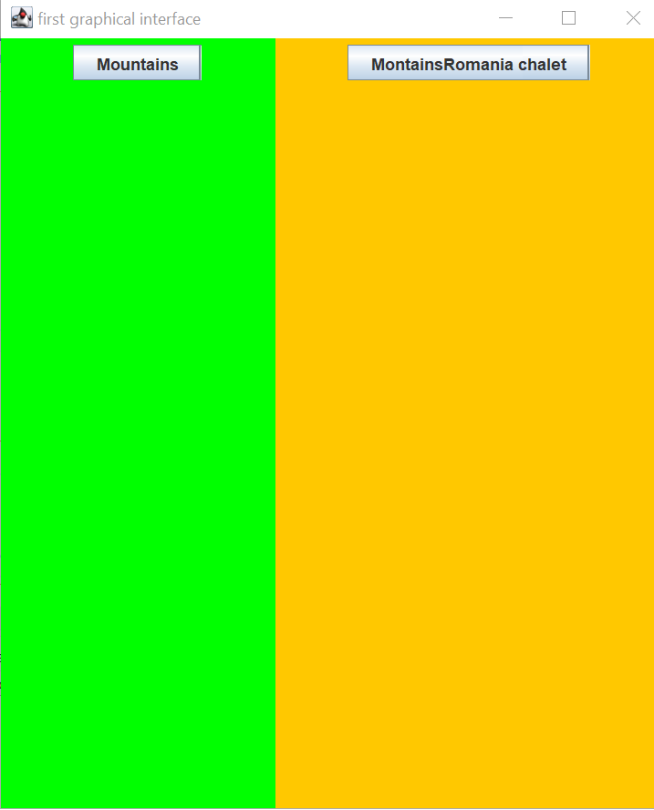
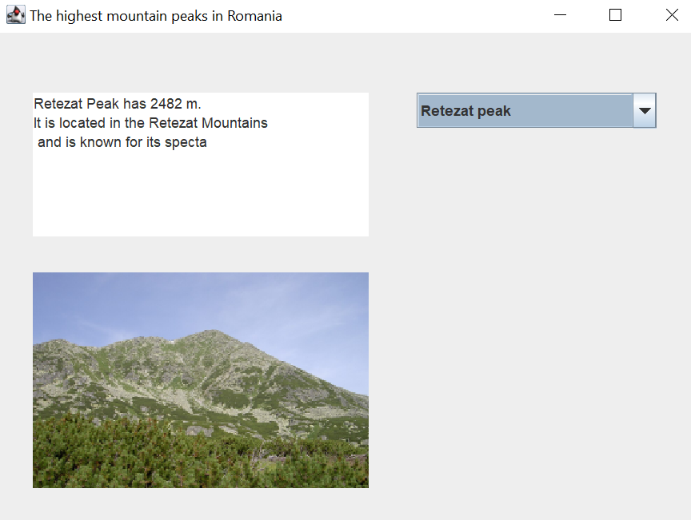

# MountainsRomania

# Description
This project  is a graphical interface, built with the Java programming language.
The application build with Eclipse IDE.

# User Interface Design

- click on the "Mountains" button
- then open "The highest mountain peaks in Romania" interface
- then selected Retezat peak

